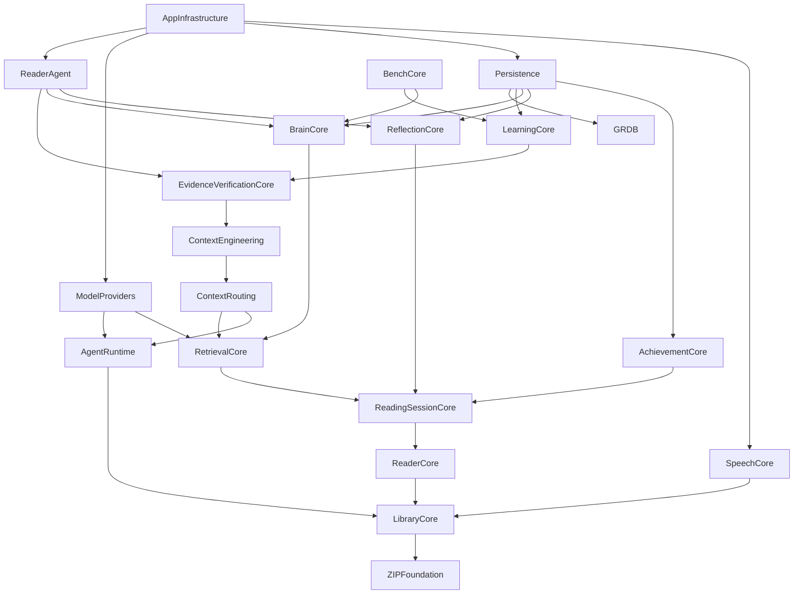
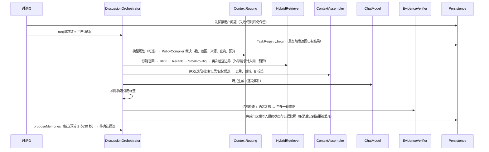

# 架构说明

思迹（ThoughtTrail）由一个 Swift Package（18 个库模块 + 测试 + 命令行工具）和一个 iOS App 工程（`App/`、`UITests/`，由 `project.yml` 经 XcodeGen 生成）组成。核心逻辑全部在库模块中，可在 macOS 上运行离线测试；App 只做界面、平台适配与装配。

## 1. 18 个库模块

| 编号 | 模块 | 职责 | 主要公开接口 | 主要调用方 |
|---|---|---|---|---|
| M01 | LibraryCore | EPUB 解析（ZIPFoundation + XMLParser）、正文规范化、文件指纹、导入/重复/删除策略；共享基础类型（`TextSpan`、`WallClock`、`DayKey`） | `EPUBParser`、`LibraryService`、`BookRepository`、`BookFileStore`、`LibraryQuery` | App 书库页、AppInfrastructure、Persistence、tt-bench |
| M02 | ReaderCore | 稳定定位（版本 + 章节资源 + UTF-16 区间 + 文本锚点）、重新定位、分页模型、批注/书签/阅读位置 | `Locator`、`LocatorResolver`、`ReaderNavigator`、`Paginator`、`AnnotationService` | App 阅读器、ReaderAgent、BrainCore、Persistence |
| M03 | ReadingSessionCore | 已读区间集合（合并、裁剪）、访问范围（已读/全书）、阅读会话（停留阈值、前后台、空闲、中断恢复） | `ReadRangeSet`、`BookReadState`、`AccessScope`、`ReadingSessionTracker` | RetrievalCore、ContextRouting、ReaderAgent、App |
| M04 | ReflectionCore | 反思草稿/提交幂等/修改留痕、阅读现场快照、讨论与消息状态机、证据快照 | `ReflectionService`、`ConversationService`、`MessageStatus`、`CitationSnapshot` | ReaderAgent、App 反思与讨论页、Persistence |
| M05 | SpeechCore | 语音录入状态机：权限、录音、转写、中断、取消、无语音、时长上限、文字降级 | `VoiceCaptureController` 及平台协议 | App 反思编辑器（AVAudioRecorder/SFSpeechRecognizer 适配在 App 层） |
| M06 | RetrievalCore | 中英文分词（CJK 单字 + 二元组）、父子切块、BM25、向量索引、RRF、重排映射、Small-to-Big 扩展、索引清单与失效、增量向量化 | `HybridRetriever`、`Chunker`、`BookIndexer`、`EmbeddingService`、`RerankService`、`ChunkStore` | ReaderAgent、LearningCore、Persistence、BenchCore、tt-bench |
| M07 | ContextRouting | 语义计划结构化解析、规则编译（书籍/范围/来源/查询/预算由代码裁决）、规则降级、规划提示词 | `SemanticPlanParser`、`PolicyCompiler`、`RuleBasedPlanner` | ReaderAgent |
| M08 | ContextEngineering | 多来源候选去重、优先级与预算裁剪、证据标签映射、回答提示词、引用提取与伪造标签剔除 | `ContextAssembler`、`ContextPackage`、`Evidence`、`PromptComposer`、`CitationExtractor` | ReaderAgent、EvidenceVerificationCore、LearningCore |
| M09 | BrainCore | 观点/问题/记忆、证据引用与失效、关系、修订历史、提议校验/确认/拒绝/幂等、范围内记忆召回 | `BrainService`、`ProposalValidator`、`MemoryRecall`、`ProposalParser` | ReaderAgent、App 思考与记忆页、AppInfrastructure |
| M10 | AgentRuntime | 对话模型协议、共享预算（次数/时限/Token）、有界执行（超时/重试/取消）、完成门、任务登记幂等、追踪与脱敏、Token 估算 | `ChatModel`、`TaskBudget`、`BoundedExecutor`、`CompletionGate`、`TaskRegistry`、`TraceRecorder`、`Redactor` | 所有需要模型调用的模块 |
| M11 | ReaderAgent | 一次阅读讨论的完整编排（3.2 流程 A→N）、取消、失败语义、重试、异步记忆提议 | `DiscussionOrchestrator`、`DiscussionEvent` | App 讨论页、AppInfrastructure |
| M12 | ModelProviders | OpenAI 兼容对话（含 SSE 流）、百炼 Embedding、百炼 Rerank（原生/兼容协议）、HTTP 错误映射、连接检测 | `OpenAICompatibleChatProvider`、`DashScopeEmbeddingProvider`、`DashScopeRerankProvider`、`ConnectionChecker` | AppInfrastructure、tt-live-check、tt-bench --live |
| M13 | Persistence | SQLite/GRDB：迁移（v1/v2）、各领域仓储、FTS5 词法索引、向量 BLOB、事务、结构化备份与恢复、Markdown 导出 | `AppDatabase`、`SQLite*Repository`、`SQLiteRetrievalStore`、`BackupService`、`MarkdownExporter` | AppInfrastructure、测试 |
| M14 | AppInfrastructure | 依赖装配、Keychain 密钥、模型配置与校验、启动恢复、生命周期桥接、离线策略、权限映射、索引协调 | `AppContainer`、`ProviderHub`、`KeychainSecretStore`、`OfflinePolicy`、`PermissionMapper` | App 入口 |
| M15 | AchievementCore | 阅读日按时区与跨午夜分配、连续天数、可解释成就、去重解锁 | `HabitCalculator`、`AchievementEngine`、`AchievementService` | App 阅读记录页 |
| M16 | BenchCore | 数据集载入与冻结校验、Recall@K/nDCG/混淆矩阵/P-R、各类评测运行器、结果保存与比较、报告 | `RetrievalBenchRunner`、`VerificationBenchRunner`、`BenchRunStore` 等 | tt-bench（生产代码不依赖） |
| M17 | EvidenceVerificationCore | 陈述拆分、结构检查（ID/书籍/版本/定位/范围/删除）、语义复核（模型裁判/启发式基线）、失败语义、单轮修正策略 | `ClaimExtractor`、`StructuralChecker`、`EvidenceVerifier`、`LLMClaimJudge`、`CorrectionPolicy` | ReaderAgent、BenchCore |
| M18 | LearningCore | 出题校验（证据/范围/泄露/重复）、作答反馈（模型/启发式，支持“不确定”）、掌握记录、1/3/7/14/30 复习调度 | `LearningService`、`QuestionGenerator`、`ReviewScheduler`、`MasteryRecord` | App 自测与复习页、BenchCore |

App target、`TestSupport`（测试桩与 EPUB 夹具）、`tt-bench`、`tt-live-check` 不计入上述 18 个库模块。

## 2. 依赖图（无循环，由 SwiftPM 保证）

约束落实：
- 领域模块（LibraryCore、ReaderCore、ReadingSessionCore、ReflectionCore、BrainCore、LearningCore 等）只定义数据结构、规则与仓储协议，不引用 GRDB、URLSession 或 SwiftUI。
- `ModelProviders` 实现 `ChatModel`（AgentRuntime）、`EmbeddingService`/`RerankService`（RetrievalCore）；`Persistence` 实现各领域仓储协议；二者都不引用 App。
- `BenchCore` 只通过公开接口调用核心能力，生产代码不依赖它。

## 3. 一次阅读讨论（ReaderAgent）

状态：`preparing → drafting → verifying → verified | needsAttention | insufficientEvidence | verificationUnavailable`，以及 `cancelled`、`failed`。终态不可再迁移；只有 `verified` 显示为“已核查”。

## 4. 关键取舍

| 主题 | 选择 | 理由与代价 |
|---|---|---|
| EPUB 显示 | 自研解析 + UITextView 正文视图；**未接入 Readium** | Readium 导航器仅支持 iOS，核心包需在 macOS 上测试；自研解析让“正文 UTF-16 偏移”成为阅读器选区、定位、切块与证据的唯一坐标系，避免两套坐标映射。代价：不保留原 EPUB 的复杂排版、图片与 CSS。`ReaderTextView` 为可替换的视图层，后续可接入 Readium 并通过 `TextAnchor` 映射。这是对 3.1 计划技术的偏离，已在验收表中列出。 |
| 数据库 | GRDB；关键列建表 + 完整领域对象 JSON（payload） | 迁移与查询仍按列进行（v2 迁移示例为新增列并回填），领域模型演进时不必每次改表。使用主键 UPSERT，**禁止 `INSERT OR REPLACE`**（会因次级唯一约束静默删除旧行、并级联删除子行；测试中已发现并修复）。 |
| 中文词法检索 | 预分词：CJK 单字 + 二元组写入 FTS5（unicode61），bm25() 排序 | 不依赖默认英文分词；单字保证一字词召回，二元组提供短语精度。查询同样分词后以 OR 连接。 |
| 融合 | RRF（k=60）只用名次 | BM25 与余弦分数尺度不同；重排结果按候选下标映射，越界/重复/缺失均有处理。 |
| 范围控制 | 召回阶段过滤 + 扩展阶段裁剪 + 提交前再检查 + 复核阶段结构检查 | 多层防御；“已读”以文本区间为准，不以页码或百分比为准。 |
| 复核 | 结构检查（确定性）+ 语义裁判（模型或启发式基线） | 失败/超时不显示“已核查”；修正最多一轮且受剩余预算约束。 |
| 预算 | 每次讨论一个 `TaskBudget`，规划、查询向量、重排、生成、复核、修正、重试全部计入 | 防止多组件各自重试导致请求失控（10.2）。 |
| 幂等 | 请求键（用户消息）+ 任务登记 + 完成门 + 数据库唯一键 | 重复触发、迟到响应、取消竞争不产生重复写入。注意：本地幂等不等于远端不会重复计费。 |
