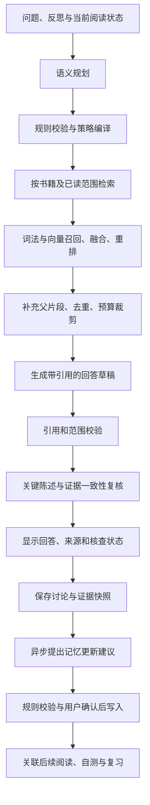

# 思迹 / ThoughtTrail：完整项目大纲与验收要求

编制日期：2026-10-17  
文档用途：统一产品范围、工程设计、开发任务和最终验收口径。  
当前状态：设计与验收基线；本文中的功能、测试数量和效果指标均为待完成目标，不是已经实现或测得的结果。

## 1. 项目定位与完成定义

思迹是一个使用 Swift 开发的原生 iOS 阅读与个人思考 Agent。它将 EPUB 原文、阅读位置、批注、个人反思和长期记忆组织起来，帮助用户在阅读中提问、核查答案、积累观点，并通过自测和复习巩固理解。

完整产品流程：

**导入书籍 → 阅读与批注 → 文字或语音反思 → 基于证据讨论 → 核查回答 → 确认长期记忆 → 自测与复习 → 在后续阅读中重新关联。**

交付一个统一名称、统一工程、统一数据模型、统一交互流程的产品。开发任务可以按依赖顺序推进，最终按整体验收，不以 V1/V2 划分成多个项目。

| 项目项 | 完整交付要求 |
|---|---|
| 客户端 | 可在 iPhone 上安装、运行和演示的原生应用；设计支持 iOS 18 及以上 |
| 业务实现 | 自己重新编码业务逻辑，使用成熟的阅读、数据库及系统能力依赖 |
| 库模块 | 18 个职责明确、被实际调用的 Swift 库模块 |
| 核心自动化 | 至少 500 个有效、唯一、实际执行通过的单元与集成测试 |
| iOS 交互自动化 | 另外至少 20 个实际执行通过的交互用例，合计目标至少 520 个 |
| 模型联调 | 对话、Embedding、Rerank 三类真实接口分别验证 |
| 效果评测 | 检索、回答依据、证据复核、长期记忆、自测均有固定数据集和结果 |
| 完成证据 | 源码、环境说明、测试原始结果、评测报告、设备验收记录、演示录像 |

数量服务于覆盖范围。18 个空模块或 520 个重复断言不能通过验收。每个模块至少有可解释的业务职责、调用方和相应测试；原定“至少 13 个模块、356 个测试”的数量要求由本方案的更高验收目标覆盖。

## 2. 用户场景与页面结构

| 页面或入口 | 用户能完成的任务 | 与其他功能的连接 |
|---|---|---|
| 书库 | 导入 EPUB、查看封面/作者/进度、搜索、打开、删除书籍 | 进入阅读器，查看索引状态 |
| 阅读器 | 翻页、目录跳转、调整字体/主题、选择文本、书签、高亮、批注 | 对选中文本提问，记录反思，点击引用返回原文 |
| 反思编辑器 | 输入文字或录音、编辑转写、保存当时的阅读上下文 | 发起讨论，生成记忆提议 |
| 阅读讨论 | 围绕选段、章节、已读内容及已确认记忆进行多轮交流 | 查看证据、核查状态、继续追问 |
| 思考与记忆 | 查看观点、问题、记忆、证据、关系、历史修订 | 确认或拒绝提议，回到原文和原始反思 |
| 自测与复习 | 按阅读范围生成练习、提交答案、查看反馈、处理到期复习 | 反馈关联证据与掌握记录 |
| 阅读记录 | 查看阅读会话、反思记录、连续阅读与成就 | 回顾过程；统计规则可解释 |
| 设置与数据 | 配置模型、检测连接、管理密钥、导出/恢复备份、管理本地数据 | 查看调用记录、错误和数据处理说明 |

主界面优先呈现读书和思考任务。调试过程、Token、检索参数等放在设置中的诊断入口。

## 3. 技术架构与主链路

### 3.1 技术组成

| 层次 | 计划技术 | 作用 |
|---|---|---|
| 语言与并发 | Swift 6、结构化并发、actor 隔离 | 业务逻辑、可取消任务、共享状态管理 |
| 界面 | SwiftUI | 原生页面、状态展示和导航 |
| EPUB 阅读 | Readium | 书籍打开、内容定位、阅读显示；应用层封装其接口 |
| 本地数据 | SQLite + GRDB | 书籍、反思、记忆、索引、任务和复习记录 |
| 词法检索 | SQLite FTS5/BM25，配合中文分词或字符切分策略 | 中文与英文关键词召回，不能仅依赖默认英文分词假设 |
| 语义检索 | 百炼 Embedding + 本地向量存储和相似度计算 | 语义匹配；按验收数据规模优化 |
| 排序 | RRF 融合 + 百炼 Rerank | 合并词法与向量结果，重排候选 |
| 模型调用 | 独立 Provider 协议与 HTTP 适配器 | 隔离不同服务、模型、错误和流式响应差异 |
| 语音 | Apple Speech / 音频系统能力 | 录音和转写；按设备、语言及网络条件处理可用性 |
| 凭据 | 系统 Keychain | 保存用户自行配置的密钥引用 |
| 测试与构建 | Swift Package Manager、Swift Testing/XCTest、Xcode | 核心逻辑测试、iOS 集成与交互验证 |

依赖版本在建工程时确认兼容性并锁定。核心包支持 macOS 测试运行；这不等于交付一个 macOS 桌面应用。

### 3.2 一次阅读讨论的执行流程



关键职责：模型提出意图和候选内容，代码控制可访问数据、实际执行、预算与写入。生成器、规划器、复核器属于有边界的任务角色，共用执行设施。

### 3.3 模块依赖约束

- 领域模块定义数据结构、规则和仓储接口，不直接访问具体 HTTP 服务或 UI。
- `ContextRouting` 决定采用什么范围和策略；`ContextEngineering` 执行候选组合、裁剪和上下文组装。
- `AgentRuntime` 提供通用执行边界，不包含具体读书业务。
- `ReaderAgent` 编排阅读讨论；`EvidenceVerificationCore` 执行陈述复核；`LearningCore` 编排自测和复习。
- `ModelProviders` 实现模型服务接口；`Persistence` 实现本地仓储接口，二者不反向调用页面。
- `AppInfrastructure` 与应用入口完成依赖装配、生命周期、权限与后台任务衔接。
- `BenchCore` 通过公开接口评测核心能力，生产业务不依赖评测模块。
- 构建依赖图必须无循环；跨模块通过明确的数据类型和协议交互。

## 4. 18 个模块及测试覆盖预算

下表为核心自动化测试的分配基线，合计 **500 个**。模块间可以按实际风险调整配额，但总数、关键场景和质量要求不降低。iOS 交互测试的 20 个另计。

| 编号 | 模块 | 实际职责 | 重点验证 | 测试预算 |
|---|---|---|---|---:|
| M01 | LibraryCore | 导入、元数据、文件指纹、书籍生命周期 | 重复导入、坏文件、删除、恢复 | 24 |
| M02 | ReaderCore | 章节、定位、书签、批注和阅读器接口 | 稳定定位、跨章、字体变化后的引用跳转 | 26 |
| M03 | ReadingSessionCore | 阅读会话、已读区间和进度 | 跳读、回退、中断恢复、区间合并 | 16 |
| M04 | ReflectionCore | 反思、讨论记录和阅读现场关联 | 草稿、修改、保存、重复提交 | 22 |
| M05 | SpeechCore | 录音、转写状态和音频生命周期 | 权限拒绝、中断、取消、无语音结果 | 16 |
| M06 | RetrievalCore | 切块、索引、召回、融合、重排、扩展 | 中文召回、边界、失效索引、排序映射 | 60 |
| M07 | ContextRouting | 语义计划、验证、策略编译和降级 | 非法计划、越界范围、错误意图、预算 | 34 |
| M08 | ContextEngineering | 多来源候选、去重、预算和组装 | 优先级、裁剪、来源隔离、证据映射 | 34 |
| M09 | BrainCore | 观点、问题、记忆、关系和修订 | 冲突、确认、拒绝、证据失效、历史 | 38 |
| M10 | AgentRuntime | 调用预算、超时、取消、事件和重试 | 竞争条件、截断、超预算、重复完成 | 34 |
| M11 | ReaderAgent | 回应、追问和整条讨论链路 | 多轮范围、草稿状态、无证据、取消 | 28 |
| M12 | ModelProviders | 对话、Embedding、Rerank 适配 | 协议、鉴权错误、流式帧、维度、顺序 | 30 |
| M13 | Persistence | 数据库、仓储、事务、迁移、备份恢复 | 原子写入、损坏备份、迁移、幂等 | 32 |
| M14 | AppInfrastructure | 服务装配、凭据、生命周期基础能力 | 配置变更、权限映射、恢复和脱敏 | 12 |
| M15 | AchievementCore | 阅读习惯、连续记录和成就规则 | 日期、时区、重复解锁、统计一致性 | 10 |
| M16 | BenchCore | 评测载入、指标、结果保存和比较 | 数据版本、分母、失败样本、重复运行 | 14 |
| M17 | EvidenceVerificationCore | 陈述拆分、证据对齐与语义复核 | 支持、矛盾、不足、未知、超时 | 32 |
| M18 | LearningCore | 出题、作答、反馈、掌握与复习 | 证据、题目重复、答案泄露、到期调度 | 38 |
| 合计 | 18 个库模块 |  |  | **500** |

模块验收：有实际源码、明确的公开接口、调用位置、关键流程和对应测试。App target、命令行工具、测试 target、文件夹不混算为上述库模块。

## 5. 功能大纲与逐项验收

本节中的“应当”“必须”均属于交付要求。每一条要求在最终验收表中对应实现位置、测试 ID、执行结果或设备验证记录。

### 5.1 书库与 EPUB

| 要求 ID | 功能 | 验收条件 |
|---|---|---|
| LIB-01 | 文件导入 | 从系统文件选择器导入有效 EPUB；封面、标题、作者和目录可显示；缺失元数据有合理默认值 |
| LIB-02 | 重复与错误处理 | 相同文件再次导入时识别重复；损坏、空文件、受保护或不支持的文件明确提示；失败不残留可见的半成品书籍 |
| LIB-03 | 书库管理 | 搜索、排序、进度展示、删除可用；导入、删除和后台索引竞争时数据保持一致 |
| LIB-04 | 书籍删除策略 | 删除阅读文件时可以保留个人笔记并标记来源不可访问；选择彻底删除时同步清理相关内容、索引和关联，结果有测试证明 |

### 5.2 阅读、定位与已读边界

| 要求 ID | 功能 | 验收条件 |
|---|---|---|
| READ-01 | 阅读体验 | 翻页、目录、字体大小、主题和书签可用；重新打开恢复阅读位置 |
| READ-02 | 批注 | 高亮、笔记新增/修改/删除立即保存；关闭并重开后存在；点击批注能回到对应文本 |
| READ-03 | 稳定定位 | 使用书籍版本、章节资源、locator 和文本锚点等信息定位；改变字体和分页后仍能找到对应原文 |
| READ-04 | 已读区间 | 记录实际标记的已读区间；直接跳到后章不自动放开中间未读内容；回看已读章节不丢失历史区间 |
| READ-05 | 多书边界 | 跨书检索逐本采用各自的已读区间；记忆、父片段和历史回答同样检查来源边界，不能通过摘要绕过 |

默认讨论范围为已读内容。用户可以明确切换到全书范围；切换必须在界面和执行记录中可见。屏幕停留只代表应用对已读范围的记录规则，不宣称能够判断用户是否真正理解。

### 5.3 反思、语音与讨论

| 要求 ID | 功能 | 验收条件 |
|---|---|---|
| REF-01 | 阅读现场 | 反思关联书籍、位置、选段、会话和时间；后续更换阅读位置不覆盖当时的证据快照 |
| REF-02 | 草稿保存 | 文字输入、编辑和恢复草稿可用；应用重启不丢失已持久化内容；连续点击保存不产生重复记录 |
| REF-03 | 语音输入 | 录音、停止、转写、人工修改、提交完整可用；权限拒绝、被来电打断或转写不可用时可以继续文字输入 |
| CHAT-01 | 基于阅读的讨论 | 支持解释选段、章节理解、观点对比和追问；可说明依据来自原文、用户反思还是长期记忆 |
| CHAT-02 | 流式与结果状态 | 接口支持时逐步显示草稿；草稿、核查中、已核查、核查失败/证据不足状态明确；生成完成不自动等于核查通过 |
| CHAT-03 | 证据不足 | 找不到足够依据时说明限制并提出补充方式；不伪造引用；一般知识补充与书内证据区分展示 |
| CHAT-04 | 中断与恢复 | 取消、断网、超时后保留用户问题和草稿；用户可重试；不把不完整回答写成成功结果 |

### 5.4 混合检索 RAG

完整流程：解析章节 → 保留定位信息的父子切块 → 词法与向量索引 → 范围过滤 → 双路召回 → RRF → Rerank → Small-to-Big 扩展 → 再次检查边界 → 提交证据集合。

| 要求 ID | 功能 | 验收条件 |
|---|---|---|
| RAG-01 | 可追溯切块 | 每个 child/parent 块都有书籍、章节、稳定文本范围和内容指纹；正文提取结果能回查到阅读器 |
| RAG-02 | 中英文召回 | 分别验证中文词语、同义表达、英文短语、专有名词、跨段问题；空文本或异常向量不进入有效索引 |
| RAG-03 | 融合与重排 | BM25、向量分数分别处理后通过 RRF 融合；重排结果正确映射到候选 ID，处理乱序、缺失和异常索引 |
| RAG-04 | 上下文扩展 | child 命中后补充 parent；去重、限制长度；跨越已读边界时裁剪或丢弃，不能整体带入后续章节 |
| RAG-05 | 索引生命周期 | 记录切块策略、Embedding 模型、向量维度和内容版本；模型或维度变化触发失效/重建，不混查不兼容向量 |
| RAG-06 | 降级和恢复 | Embedding 不可用时降级词法检索；Rerank 失败时保留融合排序；索引中断可继续，不重复插入或重复扣用本地任务计数 |

初始参数作为可调配置：两路各召回最多 50 条，融合后最多 20 条进入重排，最终最多 8 个核心证据单元，再在总上下文预算内扩展。参数调整在开发集上进行，最终评测前冻结。

### 5.5 上下文规划与组装

| 要求 ID | 功能 | 验收条件 |
|---|---|---|
| CTX-01 | 语义计划 | 计划表达意图、查询、目标书籍、数据来源和范围；采用结构化解析；畸形输出不能直接执行 |
| CTX-02 | 规则编译 | 实际书籍范围、阅读范围、可用数据、检索策略和预算由代码裁决；模型不能自行放开限制 |
| CTX-03 | 组装与预算 | 按本轮任务组合原文、批注、反思、记忆和历史；去重并保留来源映射；超预算按已定义优先级裁剪 |
| CTX-04 | 可解释降级 | 规划失败时使用可复现的规则策略；记录降级原因、使用来源、丢弃来源和预算变化 |

原文、导入文件和用户笔记作为数据处理。内容中的“忽略规则”“读取其他书籍”等文本不能改变程序的访问范围。对不具备精确 tokenizer 的模型使用保守估算并处理实际超长错误；报告中区分估算 Token 与服务端实际用量。

### 5.6 长期记忆与观点演化

| 要求 ID | 功能 | 验收条件 |
|---|---|---|
| MEM-01 | 记忆类型 | 分别表达 Thought（观点/思考）、Question（待解问题）、Memory（可复用记忆），可编辑和搜索 |
| MEM-02 | 更新提议 | 模型产出新增、关联或修订提议；经格式/来源校验和用户确认后生效；拒绝不会暗中写入 |
| MEM-03 | 证据与关系 | 记忆可追溯到原文或反思；关系表达支持、冲突、补充或延伸；自动建议和用户结论可区分 |
| MEM-04 | 修订历史 | 修改保留前后内容、时间和原因；冲突不能静默覆盖；重复处理同一讨论不会生成重复记忆 |
| MEM-05 | 跨书再关联 | 在允许的书籍和已读范围内召回相关记忆；被删除、未确认、来源失效或越界的记忆不会伪装成有效书籍证据 |

个人看法可以有反思来源，但不能据此宣称“书中已经证明”。一条记忆含有不允许使用的来源时，应剔除、拆分后重新验证，或排除整条，避免摘要泄露未读内容。

### 5.7 证据语义复核

这是完整产品中的一项重点扩展能力。引用格式正确，只能证明引用可定位；还需要判断引用是否支持回答中的陈述。

| 要求 ID | 功能 | 验收条件 |
|---|---|---|
| EVID-01 | 结构检查 | 验证证据 ID、书籍归属、定位有效性、阅读范围和删除状态；无效证据不能显示为已核查依据 |
| EVID-02 | 陈述复核 | 拆分回答中关键事实陈述，与对应证据比较；输出“支持、证据不足、存在矛盾、无法判断”及可回查理由 |
| EVID-03 | 处理结果 | 对证据不足/矛盾的结论提示不确定性，或在剩余预算内修正后重新检查；不启动无限纠错循环 |
| EVID-04 | 失败语义 | 超时、解析失败、证据缺失都不能显示为“核查通过”；可展示有明确状态的回答，用户能查看具体来源 |

复核属于质量控制机制，不承诺绝对正确。同一模型生成并复核不能作为最终质量证明，需要独立人工标注的评测数据。

### 5.8 阅读自测与复习

这是另一项重点扩展能力，与书籍、证据、反思和记忆共享数据。

| 要求 ID | 功能 | 验收条件 |
|---|---|---|
| LEARN-01 | 按范围出题 | 从已读章节/选段生成理解题、解释题或观点比较题；每题有证据、参考要点和评分依据；作答前不泄露参考答案 |
| LEARN-02 | 作答与反馈 | 保存原始答案；反馈说明正确点、遗漏点及证据；依据不足时不作确定评分 |
| LEARN-03 | 掌握记录 | 按知识点记录尝试、错误和自评；不将一次模型评分当作永久掌握结论；可人工修正 |
| LEARN-04 | 复习调度 | 采用文档化、可测试的间隔规则；可用 1/3/7/14/30 天作初始间隔，按作答表现前进、保持或回退；用固定时钟测试 |
| LEARN-05 | 复习历史 | 有到期列表、复习完成状态和历史记录；跨时区、逾期、重复提交、重新打开应用后不丢失或重复排期 |

题目、记忆和证据之间建立关联。到期复习列表是完整范围；系统推送通知不作为本次必须条件。

### 5.9 执行可靠性、数据与设置

| 要求 ID | 功能 | 验收条件 |
|---|---|---|
| RUN-01 | 有界执行 | 调用次数、总耗时、输出长度和上下文预算可配置；所有子调用共享所属任务的限制；重试计入预算 |
| RUN-02 | 幂等与恢复 | 重复触发、晚到响应、取消与完成竞争不产生重复回答、重复记忆或重复复习记录 |
| RUN-03 | 可观测记录 | 用 trace ID 关联规划、检索、模型、核查和存储；记录耗时、模型、用量/未知用量、错误和降级原因；默认不记录敏感正文 |
| DATA-01 | 数据一致性 | 讨论、证据、记忆与复习相关写入使用合理事务；数据库迁移有旧库样本；失败不破坏可恢复数据 |
| DATA-02 | 导出与恢复 | Markdown 导出方便阅读，带 schema 版本的结构化备份用于恢复；校验、重复导入、旧备份和损坏文件均有测试 |
| DATA-03 | 凭据与网络 | 密钥放 Keychain，不出现在源码、日志、截图或导出包；对话、向量和重排可以分别配置和检测 |
| DATA-04 | 离线行为 | 已下载书籍、批注、反思和已保存记忆离线可用；需要在线模型的操作显示待处理或不可用状态，不假装已完成 |
| HABIT-01 | 阅读记录与成就 | 会话统计、连续阅读和成就有明确规则；跨天/跨时区/重复事件不重复累计；可从记录解释结果 |

备份必须说明是否包含原 EPUB 和音频。恢复后，备份中存在的内容恢复可用；未包含的附件标记缺失。结构化备份不包含密钥。更换模型后不复用不兼容向量索引。

## 6. 数据模型与一致性规则

| 数据组 | 主要实体 | 必须保留的信息 |
|---|---|---|
| 书籍与阅读 | Book、Chapter、Locator、ReadInterval、ReadingSession | 文件版本、章节资源、文本范围、阅读区间与时间 |
| 阅读内容 | Annotation、Reflection、Conversation、Message | 原始内容、修改记录、关联的阅读现场和生成状态 |
| 检索 | ParentChunk、ChildChunk、IndexManifest、EmbeddingRecord | 稳定 ID、原文锚点、内容指纹、模型/维度/切块版本 |
| 证据 | Evidence、Citation、Claim、VerificationResult | 来源类别、引用范围、关键陈述、核查状态和理由 |
| 记忆 | Thought、Question、Memory、Relation、Revision、MemoryProposal | 证据、修订历史、关系、确认状态和幂等标识 |
| 学习 | LearningItem、Attempt、Feedback、MasteryRecord、ReviewSchedule | 阅读范围、题目证据、作答、评分依据和调度结果 |
| 执行与设置 | AgentTask、TraceEvent、ProviderConfig、SecretReference | 任务状态、预算、错误、模型配置及密钥引用 |

统一规则：

1. 证据与书籍版本绑定；重新导入不同内容时不静默沿用旧定位。
2. 已读权限以文本区间为依据；“最远页码”和“已读百分比”仅用于展示，不能单独决定可检索范围。
3. 删除/修订后，引用和记忆能发现来源失效，不能保留伪装有效的孤立记录。
4. 模型内容先作为候选保存，再完成必要校验和确认，不能绕过业务写入规则。
5. 网络任务使用持久化状态与幂等键支持恢复；不能把本地幂等误认为远端请求绝不会重复计费。
6. 时间以统一格式存储，按用户时区显示；复习到期与连续阅读按明确的日历规则计算。

## 7. API 方案与所需准备

### 7.1 模型方案

用户已选择千问。本文沿用阿里云百炼 / DashScope 官方服务作为接入方案；具体地域和业务空间在配置时填写。若实际使用其他平台托管的千问，必须对应调整协议、接口和模型 ID。

| 用途 | 计划服务 | 模型/配置 | 确定程度 |
|---|---|---|---|
| 语义规划、讨论、记忆提议、复核、出题 | 此前建议的 DeepSeek，或统一选择千问对话模型 | 接入时冻结实际可用模型 ID | 对话供应商尚待最终选择；不影响领域接口设计 |
| 文本向量化 | 百炼 / DashScope | text-embedding-v4 | 初选；按地域权限联调验证 |
| 候选重排序 | 百炼 / DashScope | qwen3-rerank | 初选；按地域权限联调验证 |
| 语音转写 | Apple Speech | 系统能力及目标语言 | 需要设备验证，不要求购买第三方语音 API |

上述向量和重排模型来自当前官方选型文档：[百炼向量与重排序](https://help.aliyun.com/zh/model-studio/embedding-rerank-model)。各地域的 Key、接入域名和模型列表独立；同一业务空间的模型访问还受授权范围约束，须按所选配置核验：[百炼 API Key 配置说明](https://help.aliyun.com/zh/model-studio/get-api-key)。

对话、Embedding、Rerank 使用不同接口能力，不通过“替换一把 Key”假定全部兼容。适配器必须验证批处理、输入限制、输出顺序、维度、流式帧、重排索引和错误协议。

### 7.2 开发准备清单

| 准备项 | 用途 | 何时需要 |
|---|---|---|
| Mac 与完整 Xcode、iOS 平台组件 | 编译和运行 iOS App | iOS 集成前 |
| Apple Account；可用 iPhone | 签名、真机阅读/语音/生命周期验证 | 真机验收前 |
| 百炼账号、可用额度、地域、空间、模型权限 | 向量和重排真实联调 | Provider 联调前 |
| 对话模型账号/配置 | 讨论、规划、记忆和学习功能联调 | 生成链路联调前 |
| 中英文 EPUB 与可公开的自制测试书 | 阅读测试、索引和固定评测 | 核心功能开发时 |
| 项目名称、图标、应用标识 | 统一身份与打包 | 客户端集成时 |

此项目按本地存储、用户自行配置模型服务设计，当前无需独立业务服务器、云向量数据库或自购 GPU。App Store/TestFlight 分发不纳入本次完整项目验收；需要分发时另行处理账号和上架要求。

### 7.3 数据如何流向模型

- EPUB 文件、批注、反思、记忆和数据库主要保存在设备。
- 使用云 Embedding 时，待索引的文本会发往模型服务；不能描述为“所有文本始终只在本地”。默认按已读范围增量生成云向量，避免无必要的全书预处理。
- 讨论、重排、语义复核和出题会发送对应任务所需的文本与上下文；首次配置和设置页说明这一点。
- 本地可以解析全书结构和建立本地词法索引，但所有召回与后续组装仍受阅读范围限制。
- 更换模型、增量阅读和重试时根据内容指纹复用有效索引，减少重复请求；不向日志和导出包写入密钥。

## 8. 自动化测试验收规则

### 8.1 数量与统计口径

| 类别 | 要求 | 是否计入 520 目标 |
|---|---|---|
| 领域与策略单元测试 | 成功、边界、无效输入、错误状态等 | 计入核心 500 |
| 跨模块集成测试 | 数据库、解析、检索、上下文、HTTP 协议桩、状态恢复 | 计入核心 500 |
| iOS 交互自动化 | 完整页面操作、定位、重启、配置与异常界面 | 另外至少 20 |
| 真实模型接口联调 | 三类接口分别保留真实请求的脱敏结果 | 单独报告，不用于补足 520 |
| 模型质量评测 | 固定输入集、人工标注、指标、失败样本 | 单独报告，不把评测样本自动当成测试通过数 |
| 手工/真机验证 | 录音、来电/后台中断、交互与性能 | 单独报告，不计作自动化测试 |

统计规则：

1. 以同一交付提交上的测试运行器结果为准，记录环境、时间、唯一 ID 和结果。
2. 重复运行、换设备再次运行、测试重试均不重复计数。参数化测试可以按有独立风险和断言的参数组合计数，并提供清单。
3. 跳过、禁用、未执行、预期失败和环境缺失均不能计作通过；必要场景未验证时验收保持未完成。
4. 不以空测试、仅验证构造成功、同一逻辑复制多份或无业务意义的参数穷举补数量。
5. 核心集成测试必须真正经过组件边界；至少覆盖 EPUB 解析→定位、SQLite 仓储、中文检索、上下文组装、Provider 协议和恢复写入。
6. 固定语料、时钟、随机种子与可控网络响应；核心离线测试不能依赖收费服务偶发可用性。
7. 测试失败通过修复解决；不得删除有效断言或静默跳过以凑通过数。
8. 500 个核心用例需有需求映射；每个第 5 节要求都对应自动化验证或明确的设备/人工验收项。

### 8.2 至少 20 个 iOS 交互自动化用例

| ID | 操作链与预期结果 |
|---|---|
| UI-01 | 首次启动进入书库，空状态可引导导入 |
| UI-02 | 导入有效 EPUB，元数据正确并可打开 |
| UI-03 | 再次导入同一 EPUB，显示重复处理结果 |
| UI-04 | 导入损坏 EPUB，显示错误且无残留书籍 |
| UI-05 | 阅读后退出重开，恢复位置 |
| UI-06 | 调整字体/主题，内容及定位仍可用 |
| UI-07 | 新增高亮，重启后仍可见并定位 |
| UI-08 | 编辑与删除批注，列表与正文同步 |
| UI-09 | 保存反思草稿，退出重开可继续编辑 |
| UI-10 | 从选段发起讨论，记录对应阅读现场 |
| UI-11 | 流式显示与核查状态转换正确 |
| UI-12 | 点击回答引用返回指定原文 |
| UI-13 | 取消讨论后仍可操作并可重试 |
| UI-14 | 接口错误/离线时有明确反馈且保留输入 |
| UI-15 | 确认与拒绝记忆提议，写入结果符合选择 |
| UI-16 | 查看记忆修订和来源，能回到对应记录 |
| UI-17 | 发起自测，提交前不显示参考答案，提交后有证据反馈 |
| UI-18 | 完成到期复习，列表、掌握记录及下一次排期一致 |
| UI-19 | 导出并恢复结构化备份，关键记录和引用关系一致 |
| UI-20 | 更换模型配置并执行连接检测，敏感值始终受保护 |

交互测试可以使用确定性网络响应保证可重复性，报告需明确这一点。另执行包含真实模型的完整设备演示，以及语音权限、录音、转写、后台中断的真机检查。

## 9. 模型与检索质量验收

以下阈值是本项目设定的验收目标，不是现有成绩或外部行业保证。评测前冻结数据、模型 ID、提示词、检索参数和评分规则；开发集与验收集分离。不得反复调整验收集来提高分数。模型评分可以辅助，但最终不能只依赖生成答案的同一模型自评。

### 9.1 固定数据集

| 数据集 | 最少规模 | 内容与标注 |
|---|---:|---|
| 阅读与检索语料 | 12 本 EPUB，至少 8 本中文、4 本英文 | 包括知识类与叙事类；正常及异常 EPUB 测试夹具另行准备 |
| 检索/回答验收集 | 160 个问题 | 40 个局部、40 个跨章、30 个跨书、20 个批注/记忆问题、30 个不可回答问题；每个可回答问题标注相关证据范围 |
| 阅读边界集 | 100 个场景 | 章内未读、跳读、父块扩展、跨书、未读来源记忆、历史回答、用户主动切换范围 |
| 证据复核集 | 240 组陈述与证据 | 支持、证据不足、矛盾各 80 组；含数字、否定、条件、主语和时间范围变化 |
| 记忆场景集 | 60 个场景 | 新增、重复、冲突、修订、拒绝、来源删除与恢复 |
| 自测与反馈集 | 60 组阅读任务 | 人工标注能否由已读证据作答、参考要点和反馈是否成立 |

每条数据记录 ID、来源版本、允许阅读范围、预期标签和标注说明。人工复核争议样本；模型生成的题目和标准答案必须先经人工核验再作为验收依据。最终数据可公开部分优先使用自制或可再分发材料。

### 9.2 指标与通过阈值

| 能力 | 指标 | 目标与判定 |
|---|---|---|
| 范围控制 | 检索/扩展/组装越界 | 固定 100 场景中违规数为 0；同时通过对应规则测试 |
| 检索召回 | 平均 Recall@5 / Recall@10 | 130 个可回答问题分别 ≥85% / ≥90%；相关证据按标注集合计算，避免把命中任意一条误作全部召回 |
| 检索比较 | BM25、向量、融合、融合+重排 | 同数据、范围和候选预算比较 Recall 与 nDCG；默认完整策略的 Recall@10 不低于最佳单路，重排不降低整体 nDCG@5；失败时分析并调整后重新冻结评测 |
| 无依据响应 | 不可回答识别率 | 30 个不可回答问题中 ≥90% 正确指出依据不足，且不捏造书内引用 |
| 引用结构 | 存在、可定位、范围合法 | 正式展示为有效证据的引用 100% 通过结构校验；无效引用被拦截并记录 |
| 回答依据 | 关键事实的证据覆盖率 / 支持率 | 应提供书内依据的关键事实中 ≥90% 有可核查引用；其中经人工判断确实获证据支持的比例 ≥95% |
| 语义复核 | 问题陈述识别 Precision / Recall | 将“矛盾、证据不足”作为需处理类别，Precision ≥90%、Recall ≥85%；另报各类别结果、无法判断数和混淆矩阵 |
| 长期记忆 | 提议合理率 | 60 场景中 ≥90% 的提议符合来源、重复与冲突处理规则；未确认提议正式写入数为 0 |
| 自测题目 | 可作答率 | 60 组任务中 ≥90% 可由允许的已读证据回答；有效题目的证据链接均可定位 |
| 自测反馈 | 反馈正确率 | 60 组任务中 ≥90% 的反馈与人工核验的参考要点一致；评分不确定时明确标记 |

补充口径：

- Recall@K 对每个可回答问题计算“召回的相关证据数 / 已标注相关证据总数”，再求平均。nDCG 使用预先标注的相关性等级，报告 Top-K 和实现。
- 回答拆分粒度在评分前确定；空回答或省略必要事实不能通过减少陈述来提高支持率，需同时满足回答完整性检查。
- 复核器“无法判断”单独列出；对于实际存在问题的陈述，无法判断仍计入未检出的分母，不能删掉难例后计算召回。
- 阅读边界的零违规指固定测试中的检索与上下文行为，不承诺消除模型预训练知识带来的所有剧透。出现生成侧剧透时单独记录并改进响应策略。
- 每项指标同时报告样本数、成功/失败数量、分母和代表性失败案例；单一总分不能代替分场景结果。

### 9.3 消融与成本比较

固定数据集至少比较：BM25、向量、混合、混合+重排；无父块扩展与有扩展；无语义复核与有复核；无长期记忆与有记忆。

记录质量变化、耗时、模型调用次数和 Token/费用估算。不能只展示提升的样本，也不能为了宣称模块有效而隐藏无提升或负收益的结果。用于调参的结果与最终验收结果分开保存。

## 10. 性能、稳定性与成本边界

### 10.1 性能目标

使用一台固定 iPhone 的 Release 构建验收，记录设备、系统、模型、网络、数据规模和冷/热状态。每个本地时延指标采样至少 30 次，报告 P50/P95。云模型耗时单独记录，不混入本地操作指标。

| 场景 | 验收目标 |
|---|---|
| 应用冷启动至书库可操作 | P95 ≤3 秒 |
| 已导入且已解析的书籍重新打开 | P95 ≤2 秒 |
| 批注/反思本地保存 | P95 ≤300 毫秒 |
| 用户取消后界面退出等待状态 | P95 ≤500 毫秒；迟到响应不能再次改变已取消状态 |
| 5,000 个 child chunks 的本地召回 | P95 ≤500 毫秒；不含网络 Embedding/Rerank，冷启动读索引另报 |
| 较大规模检查 | 20,000 个 child chunks 测量时延、内存和索引体积，展示规模增长曲线及瓶颈 |
| EPUB 导入与索引 | 记录 1/10/30 MB 样本的本地解析与云向量时间；展示可观察进度并支持取消/续作 |
| 持续使用 | 30 分钟阅读、批注、讨论混合操作无崩溃；记录峰值内存，不出现随重复操作持续累积的泄漏迹象 |

### 10.2 初始执行预算

| 任务 | 初始限制 | 失败或超限处理 |
|---|---|---|
| 一次前台阅读讨论 | 最多 6 次外部模型 HTTP 请求，包含规划、查询向量、重排、生成、复核及重试；总时限 60 秒 | 按阶段降级或结束并保留输入；最终有明确状态 |
| 一次前台上下文 | 初始上限估算 6,000 输入 Token 的证据/历史预算，另留系统提示与用户输入余量 | 按优先级裁剪并记录；实际总请求仍需满足模型限制 |
| 一次回答 | 初始最大生成 1,500 Token，可在设置的策略范围内调整 | 截断时说明结果不完整，不标记为完整成功 |
| 异步记忆提议 | 独立任务，最多 2 次模型请求，总时限 30 秒 | 失败可由用户重试，不影响已保存讨论 |
| 一次出题或作答反馈 | 每个任务最多 6 次模型请求，总时限 60 秒 | 不保存不完整的正式题目/评分 |
| 后台索引 | 单独的批次队列、并发与当次费用预算，不挤占前台任务预算 | 超限暂停，保留进度，用户可继续 |

这些是初始设计参数。更改时必须记录原因并更新相应测试；所有重试、修正与备用请求仍受所属任务的总预算约束。避免多个组件各自重试导致实际请求数失控。

费用报告按模型实际返回用量计算；供应商未返回用量时标记未知或估算。记录价格来源和日期，不承诺固定人民币成本，不假设免费额度。

### 10.3 必测故障

断网、弱网、401/403、限流、5xx、空响应、无效 JSON、流式截断、向量维度不符、重排索引异常、规划失败、复核超时、模型超长、磁盘写入失败、备份损坏、迁移失败、录音权限拒绝、应用转后台、进程终止、重复点击、取消后响应到达。

共同通过条件：状态可解释、用户输入和已保存数据保留、没有无限重试、没有重复业务写入、可以继续操作或按明确路径恢复。

## 11. 工程与持续验证

### 11.1 建议工程结构

```text
ThoughtTrail/
├── App/                      原生页面、导航、应用入口与平台适配
├── Sources/                  18 个 Swift 库模块
├── Tests/                    核心单元/集成测试与确定性夹具
├── UITests/                  iOS 交互自动化
├── Benchmarks/               评测配置、命令入口与比较工具
├── Evaluation/               开发集、冻结验收集及数据说明
├── Resources/                图标、颜色、字体及可分发资源
├── Scripts/                  构建、测试、统计和报告入口
├── Docs/                     架构、数据、接口、验收和使用说明
├── Package.swift
└── README.md
```

### 11.2 工程验收

- 按 README 在干净目录中可以恢复依赖、构建核心包并执行离线测试。
- Swift 6 构建通过；并发问题不通过无解释的全局关闭检查处理。
- iOS 应用能构建、安装、启动，核心页面没有空壳入口。
- 覆盖声明的最低支持系统和一个较新可用系统；记录实际 OS/SDK，缺少环境的项目标记未验收。
- 核心离线测试与 iOS 交互测试纳入可重复执行的检查流程；真实 API 评测显式触发，避免每次提交都产生费用。
- 发布验收绑定同一源码提交、依赖锁定文件、测试报告和评测配置。
- 不以行覆盖率代替正确性；补充收集可获得的覆盖率，重点审查阅读边界、事务、幂等、预算、取消和重试的分支覆盖。
- 关键页面有可访问的名称、足够可读的字体和错误反馈；适配深浅色、键盘和较小屏幕，不遮挡主要操作。

## 12. 开发任务顺序与依赖

以下是同一工程内的工作包，全部完成后统一交付。

| 工作包 | 主要工作 | 产出与进入后续工作的条件 |
|---|---|---|
| A. 工程与契约 | 建工程、模块接口、数据实体、固定夹具、测试入口 | 基础编译与最小数据库/协议测试可运行 |
| B. 阅读与本地数据 | 导入、Readium、定位、批注、会话、反思、语音 | 本地读书与记录流程可用，已读区间有可靠数据来源 |
| C. 检索与模型适配 | 中英文切块、双路索引、百炼适配、RRF、重排、边界 | 检索集和三类 Provider 联调有记录 |
| D. 上下文与讨论 | 规划、规则编译、组装、流式回复、执行预算、引用 | 从阅读现场到带来源回答的整条链路可用 |
| E. 记忆与语义复核 | 提议、确认、证据、关系、修订、陈述核查 | 可演示观点变化和证据不足的处理 |
| F. 自测与复习 | 出题、反馈、掌握、排期、历史、统计 | 一次阅读可完整转化为练习及复习任务 |
| G. 整体验收 | 性能、故障、UI、真实 API、固定评测、文档与录像 | 达到第 13 节所有交付门槛 |

测试随对应功能一起完成。工程骨架和确定性核心逻辑可以先推进；iOS 编译、语音、真实模型和设备性能分别依赖对应环境，不因缺少条件而记为通过。

## 13. 最终验收清单与交付物

### 13.1 整体通过条件

| 验收 ID | 必须通过的条件 | 证据 | 当前状态 |
|---|---|---|---|
| ACCEPT-01 | 18 个真实库模块，职责和依赖清楚 | 模块清单、依赖图、实际调用位置 | 待实现 |
| ACCEPT-02 | 第 5 节全部功能要求落实 | 需求—代码—测试/设备记录映射 | 待实现 |
| ACCEPT-03 | ≥500 核心自动化与 ≥20 iOS 交互测试通过 | 唯一 ID 清单、运行器原始输出、失败/跳过明细 | 待验收 |
| ACCEPT-04 | iOS 构建、安装、核心页面和完整演示通过 | 构建记录、设备/系统信息、录像 | 待验收 |
| ACCEPT-05 | 对话、Embedding、Rerank 真实接口可用 | 脱敏联调记录，模型/地域/协议配置 | 待配置与验收 |
| ACCEPT-06 | 阅读边界、引用有效性和预算规则通过 | 边界集、规则测试和执行记录 | 待验收 |
| ACCEPT-07 | 检索、回答依据、复核、记忆、自测达到约定阈值 | 冻结数据集、指标、人工核验与失败案例 | 待验收 |
| ACCEPT-08 | 性能、取消、故障恢复达到要求 | 固定设备性能报告、故障验证记录 | 待验收 |
| ACCEPT-09 | 数据迁移、导出恢复与删除行为正确 | 旧库/备份样本、恢复前后校验和测试 | 待验收 |
| ACCEPT-10 | 文档及演示可供他人复核和复现 | README、架构说明、评测说明、操作指南 | 待交付 |

整体验收不能遗留阻塞主流程、数据丢失、越界检索、重复写入或明文密钥暴露的问题。其余不影响上述要求的小问题在已知限制中列明。未达到条件时标记具体未完成项，不用测试总数代替结论。

### 13.2 一次完整演示必须覆盖

1. 导入一本文字内容明确的 EPUB，阅读并做批注。
2. 记录文字或语音反思，展示与当前选段/章节的关联。
3. 发起讨论，查看回答、引用和原文跳转。
4. 展示一个回答被证据支持，以及一个证据不足/矛盾被识别的例子。
5. 展示未读范围不进入检索与上下文，跨书时各自遵守边界。
6. 确认一条记忆，随后修订并查看来源与历史。
7. 基于已读内容生成自测、提交答案、查看反馈和下一次复习时间。
8. 展示取消/断网后的恢复，以及应用重启后的数据持久化。
9. 导出并恢复一份备份，确认核心记录与来源关系。

### 13.3 交付文件

- 完整源码与锁定的依赖；不包含真实密钥。
- README：项目用途、环境、配置、构建、运行和测试步骤。
- 架构说明：18 个模块、依赖图、主调用链与关键取舍。
- 数据与接口说明：实体、迁移、索引版本、Provider 配置和错误语义。
- 需求验收表：每个要求对应实现和验证证据。
- 自动化测试报告：唯一用例数、通过/失败/跳过、环境、原始输出。
- 固定评测报告：数据说明、参数、指标、消融、失败样本、耗时与成本。
- 真机/模拟器验收记录、截图和完整演示录像。
- 项目讲解材料：能解释为何这样设计、失败怎样处理、指标如何算及仍有哪些限制。

## 14. 范围边界与待填配置

本次完整范围以 EPUB 阅读与思考闭环为中心。PDF/OCR、多用户协作、云同步、网页抓取、语音朗读、Android 客户端和 App Store 上架不纳入当前验收。跨书关联、语音反思、长期记忆、结构化备份、证据复核、自测复习已包含在完整范围内。

实施前需要填入的配置只有：对话供应商与模型 ID、百炼地域/业务空间、具体依赖版本、应用标识与图标、验收设备和可用系统。它们不会改变 18 个模块、完整功能和测试质量的总要求。

最终对外说明中的“已实现”“通过数量”和性能/质量结果，均从实际交付的源码与验收报告取值；本文中的目标值不直接用作项目成绩。
